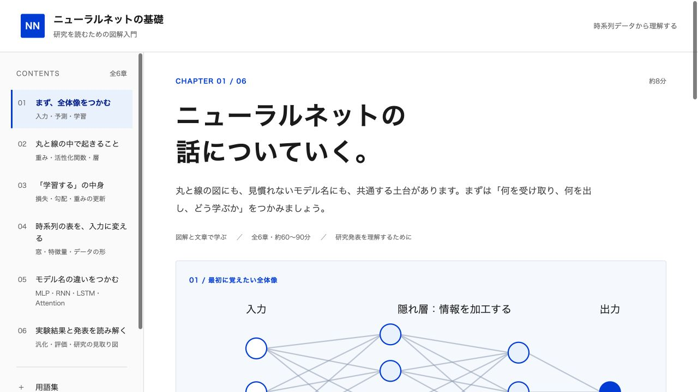

# ニューラルネットの基礎 — 研究を読むための図解入門

研究ゼミで、表形式の時系列データを用いた発表を理解するための個人用教材。図解と文章を中心にした全6章、約60〜90分が目安です。

## 開き方

同じフォルダの **`ニューラルネットの基礎.html`** をSafariやChromeなどのブラウザで開いてください。本文・SVG模式図・用語検索・進捗保存を1ファイルにまとめています。インストールやインターネット接続は不要です。外部の出典リンクを開くときは接続が必要です。

## 学習内容

1. 入力・予測・学習・推論の全体像
2. 重み・バイアス・活性化関数・隠れ層・MLP
3. 損失・勾配・誤差逆伝播・最適化・バッチ・エポック
4. 時系列の窓・入力のshape・標準化・平坦化
5. RNN・LSTM・Attention・Transformerの入口
6. 訓練／検証／テスト・過学習・評価指標・発表の読み方

別に37項目の用語集と、出典・教材の前提を収録。各章にゼミで聞く表現とその読み解き方、開閉式の短い確認、本文に対応する出典を掲載しています。数式は任意の補足です。証明やPython実習は含めません。

例は「過去7日間の室温・湿度・電力量から、翌日の電力量を予測する」で統一。すべての数値・結果表・曲線・Attentionの割合は説明用の架空例です。原資料の図や文章の転載はしていません。

## 保存と操作

- 左の目次から章を切り替えます。直接指定するURLの例：`#models`、`#glossary`。
- 最後に開いた章と、利用者が読了にした章を `neural-network-basics.progress.v1` キーに保存します。読了は取り消せます。本文内のスクロール位置や検索語は保存しません。
- 保存できない場合は状態を表示し、現在の画面で教材を利用できるようにします。
- ファイルを直接開いた場合の保存はブラウザに依存します。同じファイルの場所とブラウザで利用してください。ブラウザのデータ削除やファイル移動などで記録が消える場合があります。
- 全章の印刷ボタンは、補足を開き、用語集と出典も含めて印刷します。印刷後は補足の開閉を元に戻します。
- 狭い画面では目次と図を横スクロールできます。

## 要件とデザイン

この教材の[要件](要件.md)に従い、HTMLベース・個人利用・端末間同期なし・オフライン利用を基本にしました。デジタル庁デザインシステムを参照し、文字・色・余白・目次・ボタン・フォーカス表示を独自実装しています。公式コンポーネントのそのままの利用や、完全準拠の認証ではありません。

## 編集と再生成

- `src/content.js`：本文・用語集・出典
- `src/diagrams.js`：独自SVG模式図
- `src/style.css`：画面と印刷のスタイル
- `src/app.js`：章移動・検索・進捗保存・印刷
- `src/template.html`：画面の骨格
- `build.py`：単体HTMLと `dist/index.html` の生成

編集後、このフォルダで `python3 build.py` を実行します。Nodeや外部ライブラリは実行に不要です。

HTTPで確認する場合：`python3 -m http.server 8767 --bind 127.0.0.1 --directory dist`。同じ場所とブラウザを使う場合は、ファイルURLとHTTPの保存領域が別である点に注意してください。

## 確認記録

2026年11月5日：本文の参照元は、教科書、公式ドキュメント、Transformerの原論文を確認。

生成したHTMLをローカルHTTP経由で確認しました。

- 全6章、37項目の用語集、出典の表示。数式補足の開閉。
- 章の移動、用語から本文への復習リンク、URLに章指定がない場合の前回の章からの再開。
- 読了の記録と取り消し、ページ再読込後の保持。確認用の読了記録は取り消し、冒頭へ戻しました。
- `LSTM`と全角`ＬＳＴＭ`の検索、該当なしの表示、検索を空にした場合の全37項目の復帰。
- 1280pxと390px幅でページ全体の横方向のはみ出しなし。狭い画面では図の枠内と目次を横スクロール。
- SVG9点、重複IDなし、内部リンクの行き先欠落なし、確認中のブラウザエラーなし。
- JavaScript3ファイルの構文確認。外部スクリプト・スタイルシート・画像への依存なし。

検証用ブラウザはファイルURLを許可しないため、ファイルを直接開いた場合の表示・保存は未確認です。HTTPプレビューと配布用HTMLは同じ内容です。印刷操作は検証用のアプリ内ブラウザで応答待ちとなり、キャンセルして戻りました。実際の印刷出力のレイアウトは未確認です。
